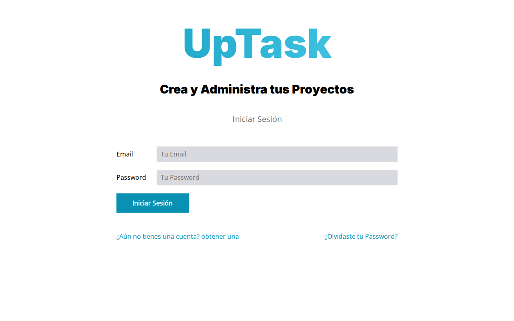
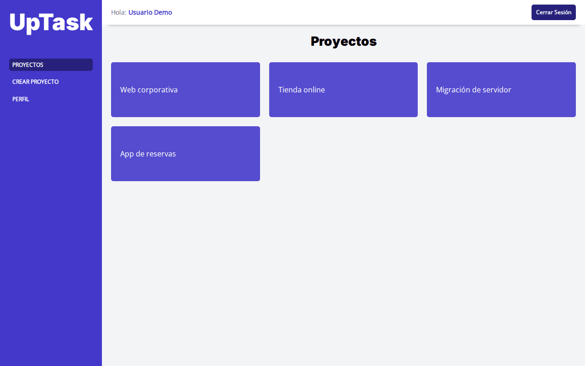
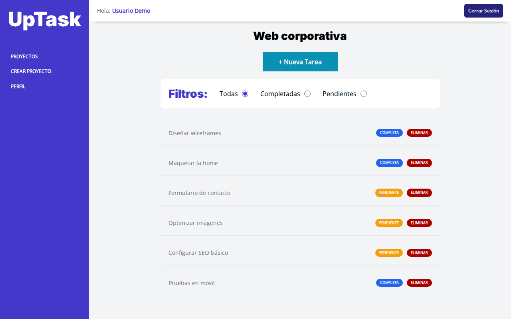

# UpTask · Gestor de proyectos y tareas en PHP MVC

> **Proyecto de formación.** Hecho siguiendo el curso *Desarrollo Web Completo* de
> Juan Pablo De la Torre Valdez ([Código Con Juan](https://codigoconjuan.com)).


Aplicación web para organizar proyectos y sus tareas. Cada usuario crea su cuenta,
la confirma por correo y gestiona sus propios proyectos. Las tareas se crean, editan,
completan y borran sin recargar la página, contra una API JSON propia.

## Funcionalidades

- Registro con confirmación de cuenta por email, inicio de sesión y recuperación de contraseña con token.
- Proyectos por usuario, cada uno con una URL única.
- Tareas con estado (pendiente / completa) y filtros, gestionadas con `fetch` contra `/api/tarea*`.
- Perfil de usuario y cambio de contraseña.
- Correos enviados con PHPMailer; configuración en `.env` con phpdotenv.

## Capturas

| Inicio de sesión | Proyectos | Tareas |
|---|---|---|
|  |  |  |

*Capturas tomadas en local con datos de ejemplo ficticios.*

## Stack

- **Backend:** PHP 8 con arquitectura MVC propia (router, `ActiveRecord` sobre mysqli).
- **Base de datos:** MySQL / MariaDB.
- **Frontend:** JavaScript sin frameworks, Sass compilado con Gulp.
- **Dependencias:** `phpmailer/phpmailer`, `vlucas/phpdotenv`.

## Cómo ejecutarlo en local

Requisitos: PHP 8 con `mysqli`, Composer y MySQL o MariaDB. `public/build/` ya está en el
repositorio, así que no hace falta compilar el frontend.

```bash
git clone git@github.com:ricardo-mendez-saoprojects/uptask-mvc-php.git
cd uptask-mvc-php
composer install
mysql -u <usuario> -p < docs/demo.sql         # crea uptask_demo con datos de ejemplo
cp includes/.env.example includes/.env        # y rellena los valores
php -S localhost:3000 -t public
```

Entra en <http://localhost:3000> con `demo@demo.test` / `demo1234`.

- `docs/demo.sql` es un esquema **reconstruido a partir de `models/`** para poder probar la
  app; el repositorio original no incluía la base de datos.
- Para recibir los correos en local basta un SMTP de pruebas como Mailpit o Mailtrap.
- El código usa interpolación `${var}`, obsoleta desde PHP 8.2: en PHP 8.2+ verás avisos
  de *deprecated* si `display_errors` está activo.
- Para recompilar Sass y JS: `npm install && npm run dev`.

## Estructura

```
├── classes/          Email (PHPMailer)
├── controllers/      Login, Dashboard y Tarea (API JSON)
├── includes/         app.php (arranque), database.php, funciones.php, .env
├── models/           ActiveRecord, Usuario, Proyecto, Tarea
├── public/           index.php (rutas) y build/ (CSS, JS e imágenes compilados)
├── src/              js/ y scss/ de origen
├── views/            auth/, dashboard/, templates/ y layout.php
├── Router.php        router propio
└── gulpfile.js
```

## Créditos

Proyecto realizado como práctica del curso *Desarrollo Web Completo* de Juan Pablo De la
Torre Valdez ([Código Con Juan](https://codigoconjuan.com)). El planteamiento y el diseño
son del curso; la implementación es mía.

<details>
<summary><strong>English</strong></summary>

# UpTask · Project and task manager in PHP MVC

> **Learning project.** Built while following the *Desarrollo Web Completo* course by
> Juan Pablo De la Torre Valdez ([Código Con Juan](https://codigoconjuan.com)).

A web app to organise projects and their tasks. Each user signs up, confirms the account
by email and manages their own projects. Tasks are created, edited, completed and deleted
without page reloads, through a small JSON API.

## Features

- Sign-up with email confirmation, login and token-based password reset.
- Per-user projects, each with a unique URL.
- Tasks with status (pending / done) and filters, handled with `fetch` against `/api/tarea*`.
- User profile and password change.
- Emails sent with PHPMailer; configuration in `.env` via phpdotenv.

## Screenshots

See the table above (local run with fictitious sample data).

## Stack

- **Backend:** PHP 8 with a custom MVC architecture (router, `ActiveRecord` on top of mysqli).
- **Database:** MySQL / MariaDB.
- **Frontend:** vanilla JavaScript, Sass compiled with Gulp.
- **Dependencies:** `phpmailer/phpmailer`, `vlucas/phpdotenv`.

## Running locally

Requirements: PHP 8 with `mysqli`, Composer and MySQL or MariaDB. `public/build/` is
committed, so no frontend build is needed.

```bash
git clone git@github.com:ricardo-mendez-saoprojects/uptask-mvc-php.git
cd uptask-mvc-php
composer install
mysql -u <user> -p < docs/demo.sql            # creates uptask_demo with sample data
cp includes/.env.example includes/.env        # then fill in the values
php -S localhost:3000 -t public
```

Open <http://localhost:3000> and log in with `demo@demo.test` / `demo1234`.

- `docs/demo.sql` is a schema **rebuilt from `models/`** so the app can be tried out; the
  original repository did not ship the database.
- Any test SMTP server (Mailpit, Mailtrap) will catch the emails locally.
- The code uses `${var}` string interpolation, deprecated since PHP 8.2: expect
  deprecation notices on PHP 8.2+ if `display_errors` is on.
- To rebuild Sass and JS: `npm install && npm run dev`.

## Structure

See the tree above: `controllers/`, `models/`, `views/`, `public/` (front controller and
compiled assets), `src/` (sources) and a custom `Router.php`.

## Credits

Practice project from the *Desarrollo Web Completo* course by Juan Pablo De la Torre Valdez
([Código Con Juan](https://codigoconjuan.com)). The concept and design come from the course;
the implementation is mine.

</details>
